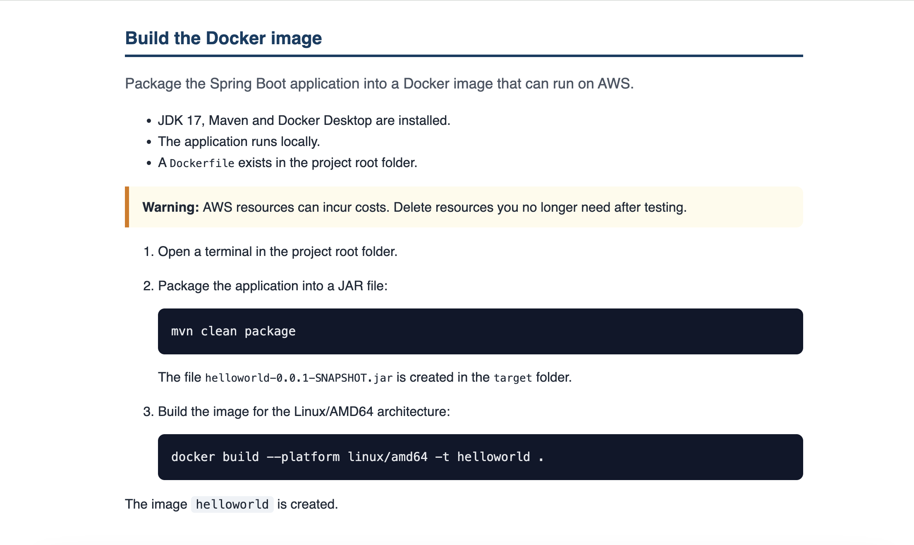
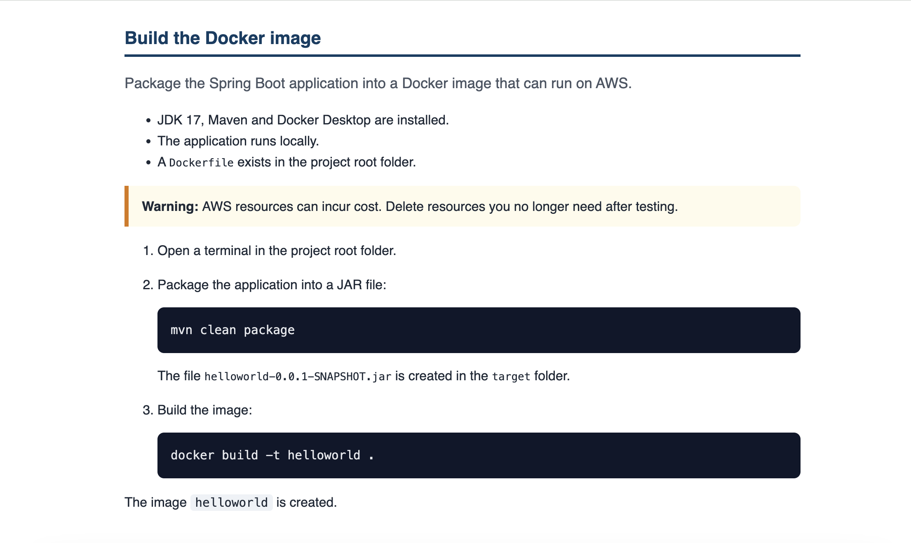

# Deploying a Spring Boot application on AWS with Docker: a DITA documentation project

A sample technical documentation project written in DITA and built with DITA Open Toolkit (DITA-OT). It turns a bachelor's thesis into a modular user guide that is published automatically with GitHub Actions.

**Live documentation:** https://annietran2023.github.io/dita-spring-boot-aws-guide/

## Purpose

I created this project to practise structured documentation: writing modular content, reusing it, and publishing several versions from one source. The content is based on my bachelor's thesis (Haaga-Helia University of Applied Sciences, 2025), which I restructured from academic prose into task-oriented instructions.

## What the guide covers

- What Docker is (concept)
- Prerequisites (reference)
- Building a Docker image for a Spring Boot application (task)
- Pushing the image to Amazon ECR (task)
- Troubleshooting (reference)

## Techniques demonstrated

| Technique | Where |
|---|---|
| Topic types: concept, task, reference | `topics/` |
| Map to organise topics into one guide | `guide.ditamap` |
| Keys (reusable values) | `image-name` key in `guide.ditamap` |
| Content reuse with conref | Shared warnings in `shared/warnings.dita` |
| Conditional content | `platform` attribute with `apple-silicon.ditaval` and `other.ditaval` |
| Custom styling of HTML5 output | `assets/style.css` |
| Automated publishing | `.github/workflows/build.yml` |

## Single source, two outputs

The build command differs between Apple Silicon (ARM64) computers and other computers. Instead of writing two documents, each step is marked with a `platform` attribute and filtered at build time.

| Apple Silicon version | Other computers version |
|---|---|
|  |  |

## Project structure

```
.
├── guide.ditamap             Map: topic order and keys
├── topics/
│   ├── concepts/             Concept topics
│   ├── tasks/                Task topics
│   └── reference/            Reference topics
├── shared/                   Reusable content (conref)
├── apple-silicon.ditaval     Filter for the Apple Silicon version
├── other.ditaval             Filter for the other version
├── assets/                   CSS and landing page
├── build.sh                  Builds both versions
└── .github/workflows/        Automated build and publishing
```

## How to build

Requirements: Java 17 or later and [DITA-OT 4.4.1](https://www.dita-ot.org/download).

```
./build.sh
```

The output is written to `public/`. To build one version manually:

```
dita -i guide.ditamap -f html5 -o public/other --filter=other.ditaval
```

## Notes

- AWS account IDs and regions are replaced with placeholders such as `<account-id>` and `<region>`.
- See [STYLE-GUIDE.md](STYLE-GUIDE.md) for the writing conventions used in this project.

## Author

Anh (Annie) Tran, Business Information Technology graduate. [LinkedIn](https://www.linkedin.com/in/annietran00/)